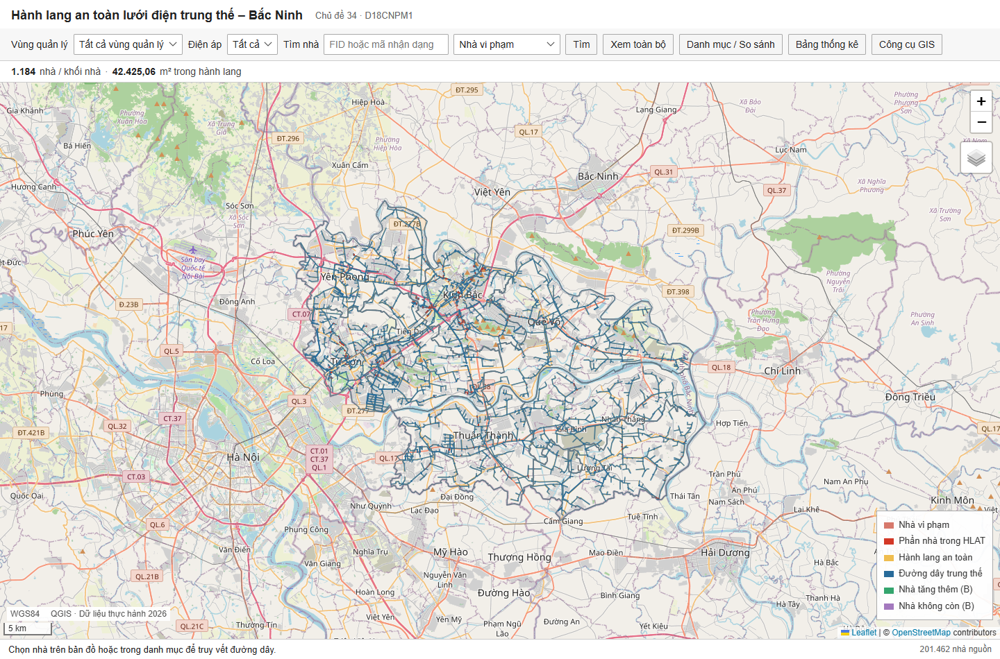
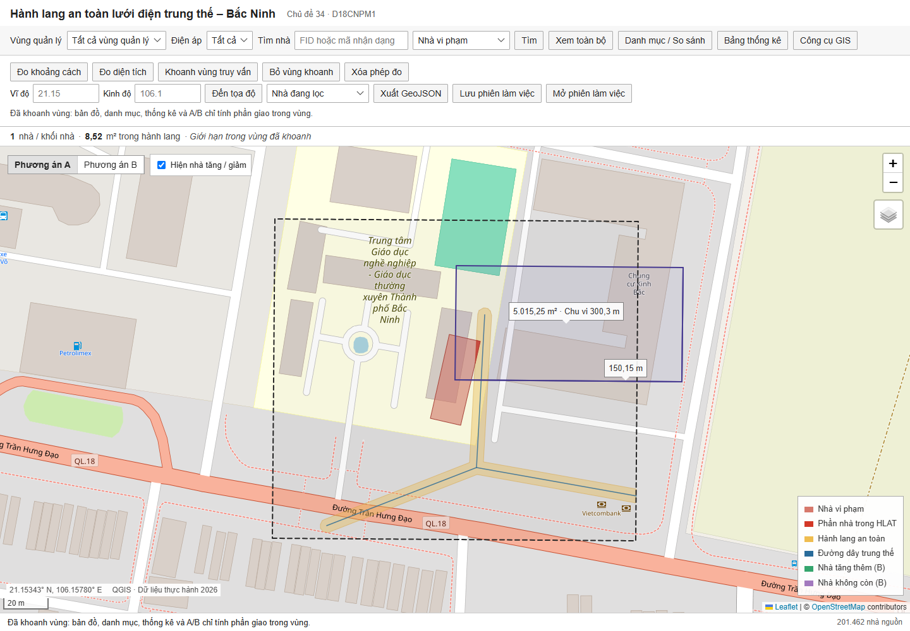

# HLAT Trung thế — Plugin QGIS

Plugin xử lý không gian để giám sát phần **nhà và khối nhà nằm trong hành lang an toàn lưới điện trung thế**, thống kê theo vùng quản lý điện lực.

Bài tập nhóm **Hệ thống thông tin không gian — D18CNPM1, chủ đề 34**. Phiên bản hiện tại: **1.2.0**, đã kiểm thử với **QGIS 3.44.13 / Python 3.12 trên Windows**.



## Chức năng

### Plugin trong QGIS

- Chọn lớp đường dây trung thế và trường cấp điện áp.
- Chọn lớp nhà/khối nhà, lớp vùng quản lý và trường tên vùng.
- Nhập khoảng cách hành lang riêng cho 35 kV, 22 kV và các cấp còn lại.
- Tạo buffer, hợp nhất phần chồng nhau, giao với nhà và chia diện tích theo vùng quản lý.
- Thêm các lớp kết quả vào map canvas của project QGIS đang mở.
- Xem danh mục, thống kê, biểu đồ; nhấp đúp bản ghi để chọn và phóng tới nhà.
- Lưu GeoPackage, danh mục CSV, thống kê CSV, nhật ký và thông tin lần chạy.
- Xuất bản đồ PDF tổng quan/chi tiết và bản đồ web tương tác.
- Chạy nền, hiển thị tiến độ, hỗ trợ hủy và giữ các lần chạy trước bằng tên tệp riêng.

### Bản đồ web

- Kéo, phóng to/thu nhỏ, bật/tắt lớp và dùng nền OpenStreetMap.
- **Nhấp trực tiếp nhà** để mở thông tin và đường dây liên quan: điện áp, khoảng cách, diện tích giao và vị trí. Khi zoom từ 16, có thể nhận diện cả nhà nguồn ngoài danh sách vi phạm.
- Tìm theo FID hoặc mã nhận dạng trong kết quả vi phạm hoặc toàn bộ nhà nguồn.
- Lọc đồng bộ bản đồ, danh mục và thống kê theo vùng quản lý, cấp điện áp.
- So sánh **A/B**: hai bộ khoảng cách hành lang trên cùng dữ liệu, xem số nhà và diện tích tăng/giảm.
- Vẽ vùng truy vấn để giới hạn phép tính của cả A/B; đo khoảng cách và diện tích bằng CRS mét.
- Xuất CSV, GeoJSON; lưu/mở phiên làm việc gồm tham số, vùng khoanh, phép đo và khung nhìn.
- Đi đến vị trí bằng vĩ độ/kinh độ WGS84.



## Cài đặt và mở demo

### 1. Lấy mã nguồn

```powershell
git clone https://github.com/deno4908/HLAT_TrungThe.git
cd HLAT_TrungThe
```

Cũng có thể chọn **Code → Download ZIP** trên GitHub rồi giải nén.

### 2. Cài plugin vào QGIS

1. Mở QGIS 3.44.
2. Chọn **Plugins → Manage and Install Plugins → Install from ZIP**.
3. Chọn [hlat_trungthe_34.zip](hlat_trungthe_34.zip) trong thư mục repo.
4. Bật **HLAT Trung thế - Chủ đề 34** trong danh sách plugin đã cài.
5. Mở plugin từ menu **Plugins → HLAT Trung thế** hoặc biểu tượng cột điện.

Không chọn ZIP tải toàn bộ repo để cài plugin. Plugin sử dụng PyQGIS và Qt có sẵn trong QGIS; không cần cài thêm gói Python để chạy phân tích.

### 3. Mở dữ liệu mẫu

Mở [demo/ChuDe34_BacNinh.qgz](demo/ChuDe34_BacNinh.qgz) trong QGIS. Project dùng đường dẫn tương đối tới dữ liệu và kết quả kèm repo.

Trên Windows, có thể chạy:

```powershell
.\Mo_Demo_QGIS.bat
```

Script tìm QGIS trong `Program Files`, cài plugin vào profile riêng `chude34` rồi mở project demo. Có thể đọc [Mo_Demo_QGIS.ps1](Mo_Demo_QGIS.ps1) để xem chi tiết.

### 4. Chạy phân tích

1. Bấm **Nạp dữ liệu Bắc Ninh…**, chọn thư mục `demo/data`.
2. Kiểm tra ba lớp đầu vào, trường `capDienAp` và trường vùng `TenKVQLDL`.
3. Giữ tùy chọn chỉ lấy **Nhà / Khối nhà** khi dùng dữ liệu môn học.
4. Nhập khoảng cách mỗi phía đường dây; mặc định **35 kV: 4 m, 22 kV: 3 m, cấp khác: 2 m** theo ví dụ trong đề.
5. Chọn CRS tính toán **EPSG:32648** và tên tệp `.gpkg` mới.
6. Bấm **Phân tích vi phạm**, sau đó xem tab kết quả và các lớp trên bản đồ QGIS.

Chương trình không ghi đè bộ kết quả đã tồn tại; hãy chọn tên mới khi chạy lại.

## Mở bản đồ web

Bản web mẫu đầy đủ nằm trong [demo/web](demo/web). Chạy:

```powershell
cd demo/web
python serve.py
```

Hoặc chạy `MoBanDoWeb.bat`. Script mở trình duyệt và máy chủ HTTP cục bộ trên một cổng trống; giữ cửa sổ máy chủ trong khi sử dụng.

Trong plugin, nút **Xuất bản đồ web…** tạo bộ web theo kết quả lần chạy hiện tại và tự mở bằng máy chủ cục bộ. Giữ QGIS mở khi dùng máy chủ do plugin tạo.

**Công cụ GIS:** nhấp các đỉnh rồi chọn **Kết thúc vẽ**. `Enter` kết thúc, `Backspace` lùi điểm, `Esc` hủy hình đang vẽ. Chọn **Tất cả vùng quản lý** để bỏ lọc vùng; **Bỏ vùng khoanh** để bỏ giới hạn do hình vẽ.

Web Worker cần **HTTP/HTTPS**. Mở trực tiếp `index.html` qua `file://` chỉ dùng chế độ xem kết quả ban đầu. Nền OpenStreetMap cần Internet; thư viện, dữ liệu và bộ tính được lưu kèm để phân tích qua máy chủ cục bộ.

[Bản mẫu trên Sites](https://bac-ninh-hlat34-d18cnpm1.cuppedridge7.chatgpt.site) hiện có quyền truy cập riêng của chủ sở hữu. Bản cục bộ trong repo dùng được mà không cần tài khoản Sites. Thông tin triển khai: [tai_lieu/ThongTin_Web.txt](tai_lieu/ThongTin_Web.txt).

## Dữ liệu và kết quả tham chiếu

Dữ liệu và template lấy từ **Bộ dữ liệu thực hành QGIS 2026** của môn học. Repo kèm bản sao ba lớp đầu vào trong [demo/data/dau_vao.gpkg](demo/data/dau_vao.gpkg).

| Thành phần | Số lượng / cấu hình |
| --- | --- |
| Đường dây đầu vào | 3.160; sử dụng 3.121 đường hợp lệ, bỏ 39 đường suy biến |
| Đối tượng nhà đầu vào | 201.493; mặc định xét 201.462 Nhà/Khối nhà |
| Vùng quản lý mẫu | 8 vùng Bắc Ninh, lọc từ lớp 17 vùng |
| CRS đo | EPSG:32648 — WGS 84 / UTM zone 48N, đơn vị mét |
| Khoảng cách 35 / 22 / cấp khác | 4 / 3 / 2 m mỗi phía |
| Nhà/khối nhà vi phạm | **1.184** |
| Diện tích phần nhà trong hành lang | **42.425,06 m²** |

Giải thuật: `Buffer theo điện áp → UnaryUnion → Intersection với nhà → Intersection với vùng → đo diện tích`.

- Chỉ tính phần giao có diện tích dương; chạm biên không được tính là vi phạm.
- Hợp nhất hành lang trước khi đo để tránh cộng trùng vùng chồng nhau.
- Dùng `source_fid` làm khóa đối chiếu vì mã nhận dạng có thể trùng hoặc trống.
- Một nhà qua ranh giới được chia diện tích theo vùng; số nhà giữa các vùng có thể không cộng thành tổng duy nhất.
- Mô hình phân tích là hình học phẳng 2D. Các khoảng cách được cấu hình theo bài tập; dữ liệu không mô tả chiều cao công trình hay vị trí dây ngoài cùng.

Kết quả ban đầu của web lấy từ QGIS. Các lần tính lại, bộ lọc và vùng khoanh dùng **GEOS-WASM trên CRS mét**; hình học chuyển sang WGS84 để hiển thị.

## Tệp đầu ra

Với tên kết quả `hlat_bac_ninh.gpkg`, plugin tạo:

| Tệp / lớp | Nội dung |
| --- | --- |
| `hlat_bac_ninh.gpkg` | Các lớp `hanh_lang`, `nha_vi_pham`, `phan_vi_pham`, `thong_ke_vung` |
| `hlat_bac_ninh_danh_muc.csv` | Danh mục phần nhà vi phạm theo từng vùng |
| `hlat_bac_ninh_thong_ke.csv` | Số nhà và diện tích theo vùng, đơn vị m² và ha |
| `hlat_bac_ninh_nhat_ky.csv` | Các bản ghi bị bỏ hoặc được sửa hình học trên bản sao |
| `hlat_bac_ninh_thong_tin.json` | Tham số, CRS, thời gian và số liệu tổng hợp |

Kết quả mẫu: [demo/ket_qua](demo/ket_qua). Bản đồ in: [demo/BanDo_HLAT_TrungThe.pdf](demo/BanDo_HLAT_TrungThe.pdf).

## Cấu trúc repo

```text
HLAT_TrungThe/
├── plugin/hlat_trungthe_34/   # Mã plugin, template và tài nguyên web
├── demo/
│   ├── data/                 # Ba lớp đầu vào trong GeoPackage
│   ├── ket_qua/              # GeoPackage, CSV, JSON kết quả
│   ├── styles/               # QML từ bộ mẫu môn học
│   └── web/                  # Web có sẵn dữ liệu để chạy cục bộ
├── assets/                   # Ảnh giao diện và bản đồ
├── tai_lieu/                 # Báo cáo, hướng dẫn, slide và kịch bản
├── tests/                    # Kiểm thử PyQGIS và trình duyệt
├── kiem_thu/                 # Bằng chứng chạy và đối chiếu số liệu
├── scripts/                  # Tái tạo demo, tài liệu và đóng gói
├── hlat_trungthe_34.zip       # ZIP cài trực tiếp vào QGIS
├── Mo_Demo_QGIS.bat
├── Mo_Demo_QGIS.ps1
└── SHA256.json               # Mã kiểm tra bộ bàn giao
```

Nguồn web của plugin nằm tại `plugin/hlat_trungthe_34/web/`. Sau khi sửa, dùng `scripts/prepare_web.py` để tái tạo `demo/web`. Checkout riêng `web_site/` dành cho hosting được loại khỏi repo GitHub để tránh lồng Git và trùng dữ liệu.

## Kiểm thử và phát triển

Chạy các lệnh sau từ thư mục gốc repo; điều chỉnh đường dẫn nếu QGIS cài ở vị trí khác:

```powershell
& "C:\Program Files\QGIS 3.44.13\bin\python-qgis-ltr.bat" tests/test_analysis.py
& "C:\Program Files\QGIS 3.44.13\bin\python-qgis-ltr.bat" tests/check_native.py
& "C:\Program Files\QGIS 3.44.13\bin\python-qgis-ltr.bat" tests/check_web_export_qgis.py
.\scripts\run_qgis_smoke.ps1
```

Kiểm tra web bằng Python riêng có `playwright` và **Microsoft Edge**:

```powershell
python -m pip install playwright
python tests/check_web.py
python tests/check_gis_tools.py
```

Bộ kiểm tra hiện có **13 ca xử lý**, **22 kiểm tra web** và **12 kiểm tra công cụ GIS**. Đối chiếu native QGIS bao gồm cấu hình mặc định, mở rộng, tăng/giảm theo điện áp, lọc vùng, kết quả rỗng và vùng khoanh. Bằng chứng nằm trong [kiem_thu](kiem_thu).

Các script `scripts/build_demo.py`, `tests/build_web_reference.py`, `scripts/prepare_web.py` cần Python của QGIS. Riêng `build_demo.py` cần thư mục `Bo du lieu thuc hanh QGIS 2026` gốc đặt cạnh repo; `prepare_web.py` dùng GeoPackage đã kèm trong `demo/data`.

`build_documents.py` cần `python-docx`, `python-pptx`, `Pillow`; xuất PDF tài liệu dùng Office tương thích COM và `pywin32`. `audit_submission.py` cần thêm `pymupdf` và bộ dữ liệu môn học gốc để đối chiếu SHA-256; kiểm tra hosting riêng cần quyền truy cập bản Sites.

Đóng gói lại ZIP plugin sau khi sửa mã:

```powershell
python scripts/package.py
```

## Tài liệu bài tập nhóm

- [Báo cáo và hướng dẫn — PDF](tai_lieu/BaoCao_HuongDan_ChuDe34.pdf) · [DOCX chỉnh sửa](tai_lieu/BaoCao_HuongDan_ChuDe34.docx).
- [Slide thuyết trình — PDF](tai_lieu/ThuyetTrinh_ChuDe34.pdf) · [PPTX chỉnh sửa](tai_lieu/ThuyetTrinh_ChuDe34.pptx).
- [Kịch bản thuyết trình](tai_lieu/KichBan_ThuyetTrinh.txt).

Trước khi nộp, điền tên nhóm, giảng viên, họ tên/MSSV và phân công thực tế trong tài liệu. Bảng phân công hiện là mẫu để nhóm hoàn thiện.

## Giấy phép và nguồn

Mã do nhóm viết dùng [MIT License](LICENSE.txt). Dữ liệu, QML, QPT và tài liệu môn học giữ quyền của bên cung cấp; giấy phép mã nguồn không thay đổi quyền của các tài nguyên này.

Thư viện kèm theo: **Leaflet 1.9.4** (BSD-2-Clause), **GEOS-WASM 3.1.1 / GEOS 3.13.0** (LGPL-3.0-or-later) và **Proj4js 2.12.1** (MIT). Chi tiết, nguồn và giấy phép: [vendor/NOTICE.txt](plugin/hlat_trungthe_34/web/vendor/NOTICE.txt).

Yêu cầu bài tập tham chiếu: `BaiTapNhom-HTTTKG-D18CNPM1.pdf`, chủ đề 34 tại trang 12; bộ dữ liệu và slide thực hành QGIS được cung cấp trong môn học.
